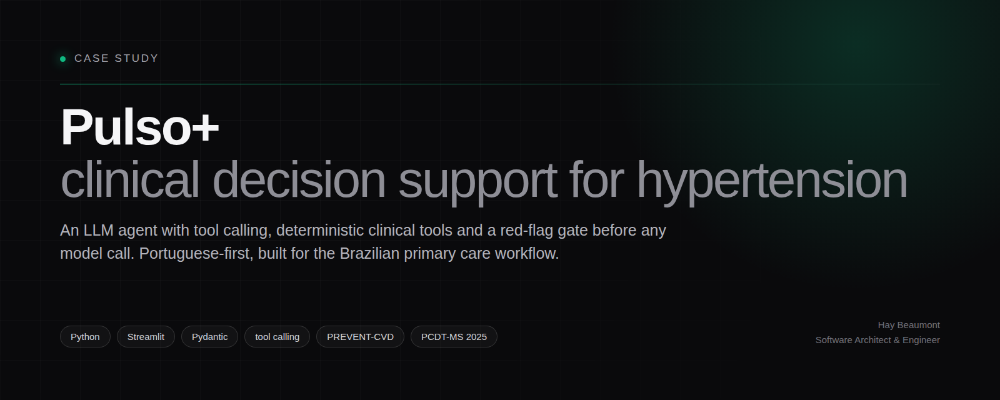
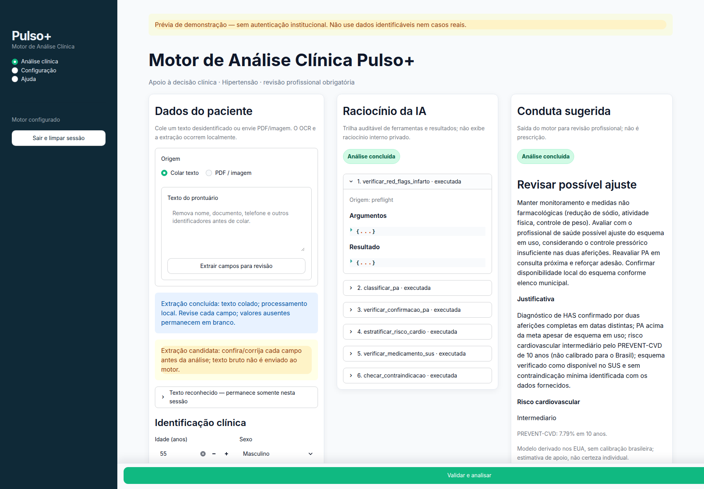
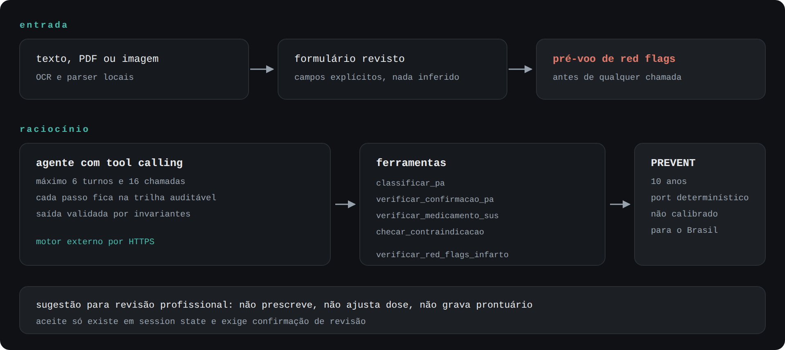
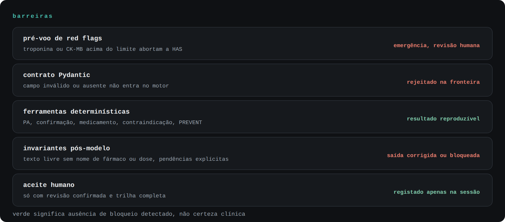
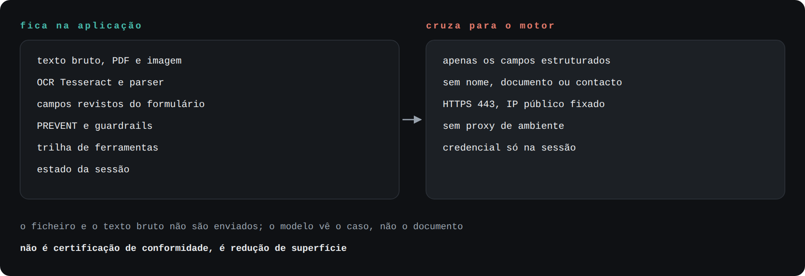

# Pulso+

Apoio à decisão clínica em hipertensão na atenção primária brasileira. O profissional preenche um formulário estruturado, um agente com LLM raciocina sobre ele usando seis ferramentas determinísticas, e o resultado chega como sugestão para revisão, nunca como prescrição.

**English:** [README.md](README.md)

> Este repositório é um estudo de caso, não o código do produto. A implementação é privada. O que está aqui é a prestação de contas de engenharia: o que o sistema faz, como está montado, quais decisões pesaram e onde estão os limites.
>
> O Pulso+ é uma demonstração. Não é dispositivo médico, não tem registro em órgão regulador, e a versão aberta não autentica identidade institucional. Não deve receber dados de pacientes reais.

## O problema

Hipertensão é o motivo mais comum de consulta na atenção primária brasileira, e a conduta não é ambígua. O protocolo do Ministério da Saúde define os limiares de pressão, a etapa de confirmação, a estratificação de risco, as classes de primeira linha e as situações que exigem encaminhamento de urgência. A dificuldade é que o protocolo é longo, a consulta é curta, e o profissional precisa sustentar quatro coisas ao mesmo tempo: a medida, a regra de confirmação, o escore de risco cardiovascular e a lista de comorbidades que proíbem determinada classe.

Dois modos de falha se repetem. O primeiro é a omissão: o caso é classificado a partir de uma única medida, a confirmação é pulada, ou o escore de risco nunca é calculado, e um paciente que deveria ser tratado com firmeza acaba acompanhado com timidez. O segundo é a ancoragem: a consulta é enquadrada como consulta de hipertensão, e um sinal de alarme que pertence a outra condição (dor torácica com troponina alterada, por exemplo) é absorvido na decisão de pressão em vez de interrompê-la.

Um modelo de linguagem é bom para ler um caso desorganizado e ruim para ser confiado com números. O desenho vem dessa separação: o modelo organiza o raciocínio e o explica, o código determinístico é dono de cada limiar, e um portão na frente do modelo recusa o caso quando outro diagnóstico tem prioridade.

## O que o produto faz

A interface é uma página em três colunas. A esquerda traz o paciente: idade, sexo, peso, altura, pressão sistólica e diastólica, comorbidades, medicação em uso, exames laboratoriais, e o envio opcional de uma anotação de consulta em texto, PDF ou imagem. A coluna do meio é o raciocínio do agente, escrito como uma trilha ordenada de chamadas de ferramenta com seus argumentos e resultados, para que o profissional veja como a conclusão foi construída. A direita é a conduta: classificação, risco, ajuste sugerido, a evidência citada por artigo e ano, e os pontos que o agente não conseguiu resolver.

Seis ferramentas carregam a lógica clínica, e cada uma devolve um objeto tipado, não prosa:

| Ferramenta | Responsabilidade |
| --- | --- |
| `verificar_red_flags_infarto` | Detecta sinais de síndrome coronariana aguda antes de qualquer outra coisa rodar |
| `classificar_pa` | Aplica os estágios de pressão do protocolo |
| `verificar_confirmacao_pa` | Verifica se uma segunda medida sustenta a classificação |
| `estratificar_risco_cardio` | Calcula o risco cardiovascular de dez anos e o mapeia para um estrato |
| `verificar_medicamento_sus` | Confirma se o fármaco está disponível na lista pública |
| `checar_contraindicacao` | Bloqueia uma classe diante das comorbidades presentes |

O agente roda com orçamento fechado: seis turnos e dezesseis chamadas de ferramenta. Um turno que esgota o orçamento termina com a declaração explícita do que não foi concluído, não com uma resposta confiante montada sobre uma trilha parcial.

A ação principal é um botão único, "Validar e analisar". O botão de aceite só fica disponível quando a saída é elegível e a trilha está completa, e o aceite é registrado no estado da sessão. Não existe gravação em prontuário, não existe exportação para o sistema da unidade, não existe persistência silenciosa.

## Arquitetura

O Streamlit serve a página e é dono da sessão. Uma camada Pydantic valida cada campo na fronteira, então valor ausente ou malformado nunca chega ao motor. O agente é um laço sobre um endpoint de chat compatível com OpenAI, com definições de ferramenta; as ferramentas são Python comum e não sabem nada sobre o modelo. A chamada externa passa por uma guarda de rede que aceita apenas HTTPS na porta 443, resolve o host uma vez, recusa endereços privados, de loopback, link-local e de metadados, e fixa o IP resolvido na requisição, para que uma segunda resposta de DNS não redirecione a conexão.

O mapa de módulos é plano de propósito. `app.py` renderiza e guarda o estado da sessão. `src/has_cdss/` guarda o domínio: esquemas, ferramentas, o modelo de risco, o laço do agente, a guarda de rede, formatação. `prompts/system_prompt.md` é carregado por caminho relativo ao pacote, então o prompt é versionado junto com o código que depende dele. `tests/` roda com `unittest discover` e cobre as ferramentas, os esquemas, o modelo de risco e o portão de sinais de alarme.

## A rede de segurança

Cinco barreiras ficam entre o formulário e a sugestão, e cada uma pode interromper o fluxo.

A primeira é o pré-voo de sinais de alarme, e roda antes de qualquer chamada ao modelo. Se a troponina está acima do limite de referência ou a CK-MB está elevada, o caso não é um caso de hipertensão. O fluxo é abortado, a saída declara emergência, e o resultado é marcado como exigindo revisão humana. Um teste de regressão injeta troponina de 2,5 e verifica que o motor de hipertensão nunca é alcançado.

A segunda é o contrato Pydantic. Os valores são tipados, as faixas são checadas, e um caso que falha na validação é recusado na fronteira com uma mensagem sobre a qual o profissional pode agir.

A terceira é a própria camada de ferramentas. Estadiamento de pressão, confirmação, risco e contraindicação são funções determinísticas com testes unitários. O modelo escolhe qual chamar e com quais argumentos; ele não calcula o resultado.

A quarta é um conjunto de invariantes aplicados ao texto do modelo antes de ser exibido. Texto livre não pode introduzir nome de fármaco ou dose que as ferramentas não devolveram, e pontos não resolvidos precisam aparecer como não resolvidos. Quando um invariante falha, a saída é corrigida ou bloqueada.

A quinta é a pessoa. A sugestão é apresentada como sugestão, o aceite é explícito, e nada sai da sessão.

## Risco cardiovascular

`estratificar_risco_cardio` é uma tradução determinística do modelo PREVENT-CVD de dez anos (modelo-base), com os coeficientes da implementação pública PyPREVENT. É aritmética em Python, não chamada de serviço, então as mesmas entradas produzem sempre o mesmo número e o número pode ser testado.

Duas propriedades importam mais que o número. A primeira é que a saída declara sua origem e seu limite: o PREVENT foi derivado de uma coorte norte-americana e não é calibrado para a população brasileira, e o texto diz isso onde o escore aparece. A segunda é que o escore é uma entrada do estrato, não o estrato. O protocolo continua decidindo o que fazer com um paciente de risco intermediário que tem diabetes ou lesão de órgão-alvo.

O cenário sintético usado na validação é um homem de 55 anos, não fumante, IMC 26, TFG estimada 90, colesterol total 190, HDL 50, sem diabetes e sem estatina, com pressões de 145/95 e 148/96. O modelo devolve 7,79 por cento, o protocolo classifica como risco intermediário com hipertensão estágio 1, e a conduta sugerida é ajustar a dose com confiança média e dois itens pendentes explícitos.

## Fronteira de dados

O material bruto não sai da aplicação. Texto, PDF e imagem são lidos localmente: Tesseract e Poppler para OCR, um parser conservador que prefere a omissão à invenção, e um formulário de revisão em que o profissional confirma cada campo extraído. O que cruza para o modelo é o caso estruturado: números, códigos, sinalizações e o texto clínico que o profissional decidiu manter.

A consequência é uma superfície menor, não uma alegação de conformidade. Não há banco de dados nem integração com prontuário, credenciais vivem no estado da sessão, e no modo de publicação pública a aplicação não lê arquivo `.env` e não recorre a chave global. Uma demonstração pública que não autentica ninguém não pode acumular registro de paciente, então ela não tem onde guardar.

## Avaliação e limites

A suíte tem 46 testes no repositório privado, cobrindo ferramentas, esquemas, modelo de risco, portão de sinais de alarme e guarda de rede. Um benchmark de 50 casos sintéticos comparou a conduta do agente com uma conduta de referência escrita a partir do protocolo. A concordância foi de 40 por cento, não houve erro crítico pelos critérios implementados, e todos os casos foram encaminhados para revisão humana.

Esse número é a informação mais útil deste repositório. Quarenta por cento de concordância significa que o agente é um segundo leitor, não um decisor, e o produto é construído em torno dessa conclusão: a trilha é visível, as incertezas são listadas, e o botão de aceite é um ato humano.

Os limites são igualmente concretos. O prompt e o conjunto de ferramentas foram ajustados sobre poucos casos sintéticos. O modelo de risco não é calibrado para a população-alvo. A disponibilidade de fármacos reflete uma fotografia da lista pública. Não há integração com sistema de prontuário, não há trilha de auditoria além da sessão, e não há camada de identidade. Cada um desses itens é um projeto, não um detalhe.

## Documentação

| Documento | Conteúdo |
| --- | --- |
| [Arquitetura](docs/pt-BR/ARQUITETURA.md) | Componentes, mapa de módulos, laço do agente, contratos das ferramentas, modos de falha |
| [Segurança clínica](docs/pt-BR/SEGURANCA-CLINICA.md) | Sinais de alarme, guardrails, invariantes, revisão humana, o que não é alegado |
| [Decisões](docs/pt-BR/DECISOES.md) | As escolhas que moldaram o sistema, com alternativas e consequências |
| [Estudo de caso](docs/pt-BR/ESTUDO-DE-CASO.md) | Contexto, restrições, o que quebrou, o que os números dizem |

Inglês: [architecture](docs/ARCHITECTURE.md), [clinical safety](docs/CLINICAL-SAFETY.md), [decisions](docs/DECISIONS.md), [case study](docs/CASE-STUDY.md).

Trechos pequenos dos padrões usados aqui, reescritos para ilustração, estão em [examples](examples/README.md).

## Stack

Python 3.12, Streamlit, Pydantic, endpoint de chat compatível com OpenAI com tool calling, Tesseract e Poppler para OCR local, `unittest` para a suíte, Docker para a imagem de implantação. A interface usa Inter servida localmente, com a paleta ancorada em `#0F2937` na barra lateral, `#F8FAFC` na superfície e `#10B981` como único acento.

## Licença

Licença de estudo de caso. Ler, citar e referenciar com atribuição; sem reuso em produto concorrente. Ver [LICENSE](LICENSE).

---

Hay Beaumont, Arquiteto de Software e Engenheiro. [github.com/yahbeaumont](https://github.com/yahbeaumont)
