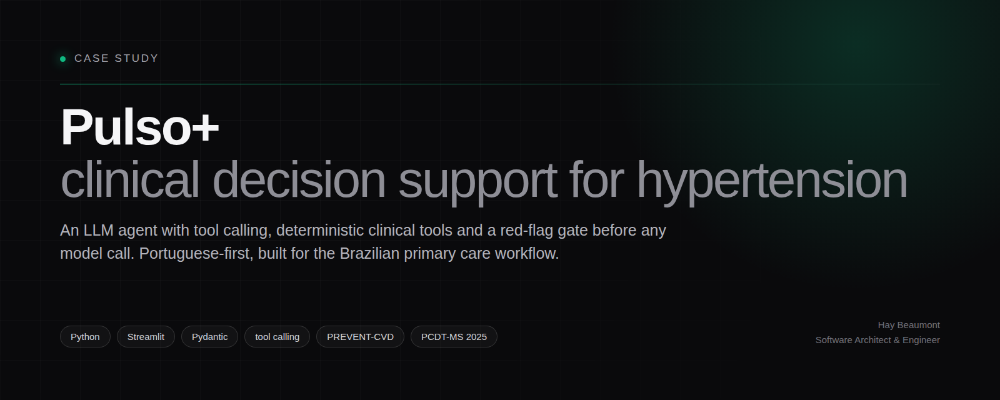
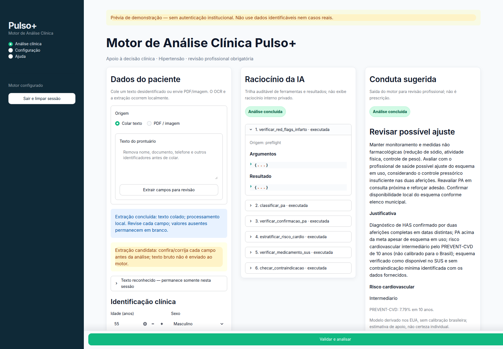
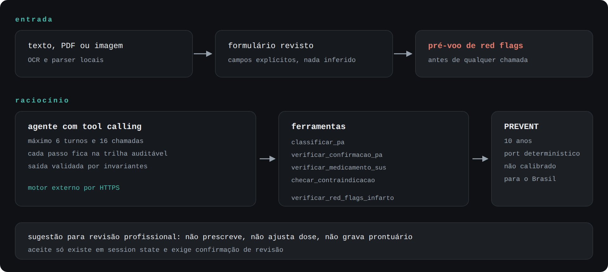
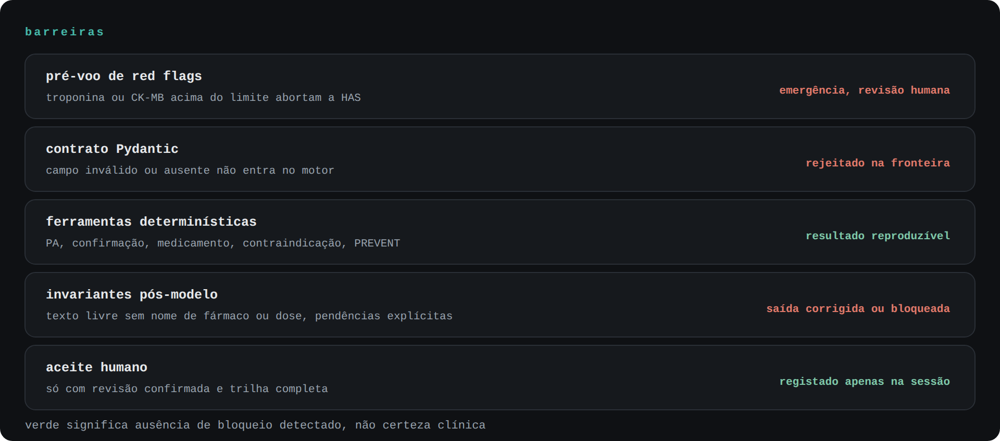
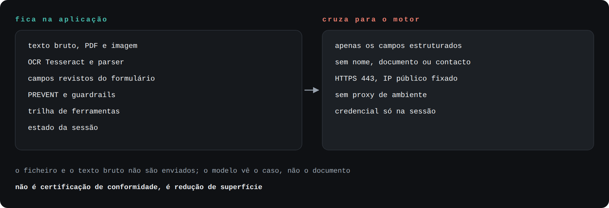

# Pulso+

Clinical decision support for hypertension in Brazilian primary care. A clinician fills a structured form, an LLM agent reasons over it with six deterministic tools, and the result arrives as a suggestion to be reviewed, never as a prescription.

**Português:** [README.pt-BR.md](README.pt-BR.md)

> This folder is the engineering account of the product. The source is in the root of this repository. What follows is what the system does, how it is put together, which decisions carried weight, and where the limits are.
>
> Pulso+ is a demonstration. It is not a medical device, it has no regulatory clearance, and the open build does not authenticate institutional identity. It must not receive real patient data.

## The problem

Hypertension is the most common reason for a primary care consultation in Brazil, and the conduct is not ambiguous. The Ministry of Health protocol defines the pressure thresholds, the confirmation step, the risk stratification, the first-line classes and the situations that require emergency referral. The difficulty is that the protocol is long, the consultation is short, and the clinician has to hold four things at once: the measurement, the confirmation rule, the cardiovascular risk score and the list of comorbidities that forbid a given class.

Two failure modes repeat. The first is omission: the case is classified from a single measurement, the confirmation step is skipped, or the risk score is never computed, so a patient who should be treated aggressively is followed conservatively. The second is anchoring: the consultation is framed as a hypertension visit, and a red flag that belongs to another condition (chest pain with a raised troponin, for instance) is absorbed into the blood pressure decision instead of stopping it.

A language model is good at reading a messy case and bad at being trusted with numbers. The design follows from that split: the model organizes the reasoning and explains it, deterministic code owns every threshold, and a gate in front of the model refuses the case when another diagnosis should take priority.

## What the product does

The interface is one page in three columns. The left column holds the patient: age, sex, weight, height, systolic and diastolic pressure, comorbidities, current medication, laboratory values, and an optional upload of a consultation note as text, PDF or image. The middle column is the agent's reasoning, written as an ordered trail of tool calls with their arguments and results, so the clinician can see how the conclusion was reached. The right column is the conduct: classification, risk, suggested adjustment, the evidence cited by article and year, and the points the agent could not resolve.

Six tools carry the clinical logic, and each one returns a typed object rather than prose:

| Tool | Responsibility |
| --- | --- |
| `verificar_red_flags_infarto` | Detects acute coronary signs before anything else runs |
| `classificar_pa` | Applies the pressure stages of the protocol |
| `verificar_confirmacao_pa` | Checks whether a second measurement supports the classification |
| `estratificar_risco_cardio` | Computes ten-year cardiovascular risk and maps it to a stratum |
| `verificar_medicamento_sus` | Confirms whether the drug is available in the public list |
| `checar_contraindicacao` | Blocks a class against the comorbidities present |

The agent runs under a hard budget: six turns and sixteen tool calls. A turn that exhausts the budget ends with an explicit statement of what was not concluded, not with a confident answer built from a partial trail.

The primary action is a single button, "Validar e analisar". The acceptance button only becomes available when the output is eligible and the trail is complete, and acceptance is recorded in session state. There is no write to a record, no export to a chart, no silent persistence.

## Architecture

Streamlit serves the page and owns the session. A Pydantic layer validates every field at the boundary, so a missing or malformed value never reaches the engine. The agent is a loop over an OpenAI-compatible chat endpoint with tool definitions; the tools are plain Python and know nothing about the model. The external call goes through a network guard that accepts only HTTPS on port 443, resolves the host once, rejects private, loopback, link-local and metadata addresses, and pins the resolved IP for the request so that a second DNS answer cannot redirect the connection.

The module map is deliberately flat. `app.py` renders and holds session state. `src/has_cdss/` holds the domain: schemas, tools, the risk model, the agent loop, the network guard, formatting. `prompts/system_prompt.md` is loaded by path relative to the package, so the prompt is versioned with the code that depends on it. `tests/` runs with `unittest discover` and covers the tools, the schemas, the risk model and the red-flag gate.

## The safety net

Five gates sit between the form and the suggestion, and each one can stop the flow.

The first is the red-flag preflight, and it runs before any model call. If troponin is above the reference limit or CK-MB is elevated, the case is not a hypertension case. The flow aborts, the output states an emergency, and the result is marked as requiring human review. A regression test feeds a troponin of 2.5 and asserts that the hypertension engine is never reached.

The second is the Pydantic contract. Values are typed, ranges are checked, and a case that fails validation is rejected at the boundary with a message the clinician can act on.

The third is the tool layer itself. Pressure staging, confirmation, risk and contraindication are deterministic functions with unit tests. The model chooses which one to call and with which arguments; it does not compute the result.

The fourth is a set of invariants applied to the model's text before it is displayed. Free text may not introduce a drug name or a dose that the tools did not return, and unresolved points must appear as unresolved. When an invariant fails, the output is corrected or blocked.

The fifth is the human. The suggestion is framed as a suggestion, the acceptance is explicit, and nothing leaves the session.

## Cardiovascular risk

`estratificar_risco_cardio` is a deterministic port of the ten-year PREVENT-CVD base model, using the coefficients of the public PyPREVENT implementation. It is Python arithmetic, not a service call, so the same inputs always produce the same number and the number can be tested.

Two properties matter more than the number. The first is that the output declares its own provenance and its own limit: PREVENT was derived from a North American cohort and is not calibrated for the Brazilian population, and the text says so where the score appears. The second is that the score is one input to the stratum, not the stratum itself. The protocol still decides what to do with a patient at intermediate risk who has diabetes or target organ damage.

The synthetic scenario used for validation is a 55-year-old man, non-smoker, body mass index 26, eGFR 90, total cholesterol 190, HDL 50, no diabetes and no statin, with pressures of 145/95 and 148/96. The model returns 7.79 percent, the protocol classifies the case as intermediate risk with stage 1 hypertension, and the suggested conduct is to adjust the dose with medium confidence and two explicit pending items.

## Data boundary

The raw material never leaves the application. Text, PDF and image inputs are read locally: Tesseract and Poppler for OCR, a conservative parser that prefers omission to invention, and a review form where the clinician confirms each extracted field. What crosses to the model is the structured case: numbers, codes, flags, and the clinical text the clinician chose to keep.

The consequence is a smaller surface, not a compliance claim. There is no database and no chart integration, credentials live in session state, and in the public deployment mode the application reads no `.env` file and falls back to no global key. A public demonstration that authenticates nobody cannot be allowed to accumulate patient records, so it does not have anywhere to put them.

## Evaluation and limits

The validated suite has 46 tests, covering the tools, the schemas, the risk model, the red-flag gate and the network guard. A benchmark of 50 synthetic cases compared the agent's conduct against a reference conduct written from the protocol. Agreement was 40 percent, there were no critical errors under the criteria implemented, and every case was routed to human review.

That number is the most useful thing in this repository. Forty percent agreement means the agent is a second reader, not a decision maker, and the product is built around that conclusion: the trail is visible, the uncertainties are listed, and the accept button is a human act.

The limits are equally concrete. The prompt and the tool set were tuned on a small number of synthetic cases. The risk model is not calibrated for the target population. Drug availability reflects a snapshot of the public list. There is no integration with a record system, no audit log beyond the session, and no identity layer. Each of those is a project, not a detail.

## Documentation

| Document | Content |
| --- | --- |
| [Architecture](docs/ARCHITECTURE.md) | Components, module map, agent loop, tool contracts, failure modes |
| [Clinical safety](docs/CLINICAL-SAFETY.md) | Red flags, guardrails, invariants, human review, what is not claimed |
| [Decisions](docs/DECISIONS.md) | The choices that shaped the system, with alternatives and consequences |
| [Case study](docs/CASE-STUDY.md) | Context, constraints, what broke, what the numbers say |

Portuguese: [arquitetura](docs/pt-BR/ARQUITETURA.md), [segurança clínica](docs/pt-BR/SEGURANCA-CLINICA.md), [decisões](docs/pt-BR/DECISOES.md), [estudo de caso](docs/pt-BR/ESTUDO-DE-CASO.md).

Small excerpts of the patterns used here, rewritten for illustration, are in [examples](examples/README.md).

## Stack

Python 3.12, Streamlit, Pydantic, an OpenAI-compatible chat endpoint with tool calling, Tesseract and Poppler for local OCR, pytest-style `unittest` for the suite, Docker for the deployment image. The interface uses Inter served locally, with the palette anchored at `#0F2937` for the sidebar, `#F8FAFC` for the surface and `#10B981` for the single accent.

## License

MIT, like the rest of the repository. See [LICENSE](../LICENSE).

---

Hay Beaumont, Software Architect and Engineer. [github.com/yahbeaumont](https://github.com/yahbeaumont)
