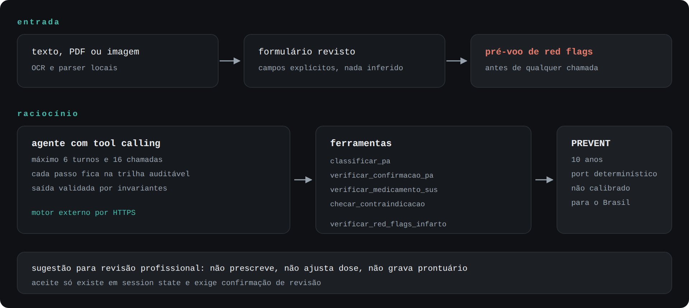

# Architecture

Pulso+ is a single Python application with one external dependency: a chat completion endpoint that supports tool calling. Everything that decides a clinical threshold runs inside the process, in code that can be read and tested without a model.

## The shape of the request

A consultation is one pass through five stages, and the application keeps the state of that pass in the session.

**Ingestion.** The clinician either types the case into the form or uploads a consultation note. Text is taken as is. PDF and image files go through local extraction: Poppler for the PDF layer, Tesseract for images, with a parser that only accepts patterns it recognizes and leaves everything else out. The result of ingestion is a proposal, never a filled form.

**Review.** The proposal lands in the same form the clinician would have typed, with each extracted field visible and editable. This is the only place where the application admits uncertainty about the input, and it is deliberate: a wrong extraction that reaches the engine produces a wrong conduct with a clean audit trail, which is worse than an empty field.

**Preflight.** Before the engine is called, the red-flag gate inspects the laboratory values. A troponin above the reference limit or an elevated CK-MB ends the pass with an emergency statement and a flag for human review. The gate exists at this position because the model must not be given the opportunity to reason about blood pressure in a case that is not about blood pressure.

**Reasoning.** The agent loop sends the structured case and the tool definitions to the endpoint, receives either tool calls or a final message, executes the tools locally, and appends their results to the conversation. The loop stops on a final message, on six turns, or on sixteen tool calls, whichever comes first.

**Output.** The final message is parsed into a typed object, checked against the invariants, rendered in the conduct column, and offered for acceptance. Acceptance writes to session state and nowhere else.

## Module map

| Path | Responsibility |
| --- | --- |
| `app.py` | Page layout, form, three columns, session state, acceptance flow |
| `src/has_cdss/schemas.py` | Pydantic models for the case, the tool results and the final output |
| `src/has_cdss/tools.py` | The six clinical tools, pure functions over typed input |
| `src/has_cdss/prevent.py` | Ten-year PREVENT-CVD base model, ported coefficients |
| `src/has_cdss/agent.py` | Loop, tool dispatch, budget, prompt resolution, output parsing |
| `src/has_cdss/guardrails.py` | Invariants applied to the model's text before rendering |
| `src/has_cdss/public_network.py` | Egress guard: scheme, port, address class, IP pinning, no ambient proxy |
| `src/has_cdss/formatting.py` | Presentation helpers, units, pressure notation |
| `prompts/system_prompt.md` | The operating instruction, versioned with the code |
| `tests/` | Unit and regression tests, `unittest discover` |

The package resolves the prompt through `parents[2] / "prompts" / "system_prompt.md"`, which means the prompt travels with the package and cannot silently diverge from the code in a deployed image. There is no configuration file that points at a prompt elsewhere.

## Tool contracts

Every tool takes a Pydantic model and returns one. None of them returns a string, and none of them logs free text. That constraint is what makes the trail useful: the middle column can render arguments and results as data, and the invariants can compare what the model wrote against what the tools actually returned.

| Tool | Input | Output |
| --- | --- | --- |
| `verificar_red_flags_infarto` | Troponin, CK-MB, symptoms | Boolean, reason, required action |
| `classificar_pa` | Systolic, diastolic, context | Stage, label, protocol reference |
| `verificar_confirmacao_pa` | Two or more readings | Confirmed, pending, recommended repeats |
| `estratificar_risco_cardio` | Age, sex, pressure, lipids, eGFR, smoking, diabetes, treatment | Percentage, stratum, model provenance |
| `verificar_medicamento_sus` | Drug name, presentation | Available, alternative, source |
| `checar_contraindicacao` | Drug class, comorbidities, pregnancy, renal function | Allowed, forbidden, reason |

The tool descriptions given to the model are short and imperative, because the failure mode of a long description is a model that calls the tool as a formality after having already decided. Each description states when the tool must be called, not only what it computes.

## The agent loop

The loop is small on purpose. It holds a message list, a turn counter and a tool-call counter. On each iteration it sends the list and the tool schemas, then either dispatches the requested tools or terminates. Tool errors are returned to the model as structured errors rather than raised, so a malformed argument produces a correction attempt instead of a broken session. When the budget is exhausted, the loop synthesizes a partial result that names what was not concluded; it does not ask the model to summarize a trail it did not finish.

Two details matter for reproducibility. Temperature is low, and the tool definitions are sorted, so the same case produces the same tool order in almost every run. The trail is stored as a list of records with the tool name, the arguments, the result and the elapsed time, which is what the interface renders and what a reviewer reads.

## Egress guard

`public_network.py` exists because the endpoint is configurable. A clinician or an evaluator can point the application at any OpenAI-compatible URL, and that URL is a place where credentials and clinical text would go. The guard enforces four rules before a connection is opened: HTTPS only, port 443 only, the resolved address must be public and global, and the connection is made to the pinned address with the original host preserved for TLS and SNI. Ambient proxy variables are ignored, so an environment cannot quietly reroute the call. Redirects are not followed.

This is not a substitute for a network policy. It is the check that a misconfigured endpoint fails loudly at the boundary instead of sending a case to an address that should never receive it.

## Failure modes

| Failure | Behaviour |
| --- | --- |
| Model returns prose instead of a tool call | Parsed as a final message, invariants applied, unresolved items listed |
| Tool argument invalid | Structured error returned to the model, one retry, then reported |
| Budget exhausted | Partial output with explicit gaps, no acceptance button |
| Endpoint unreachable | Error state in the reasoning column, form preserved, nothing lost |
| Endpoint resolves to a private address | Refused by the guard, message names the reason |
| Extraction produces nothing usable | Empty form, no invented values |
| Output introduces a drug or dose not in the tools | Invariant blocks the block of text, output marked incomplete |

## Deployment

The image is a Docker build with the package, the prompt, the local fonts and a pinned dependency set. The public mode sets a flag that disables `.env` loading and the global fallback key, so a deployment without a session key simply cannot call the engine. Health is a page render, not a liveness endpoint, because the failure that matters here is a page that loads with a broken session.

## Testing

`unittest discover` runs the suite without network access. The tests cover the pressure stages at their boundaries, the confirmation rule with one and two readings, the risk model against reference values, the contraindication matrix, the red-flag gate with a raised troponin, the schemas with missing and out-of-range fields, the egress guard with loopback and metadata addresses, and the invariants with a fabricated dose. The suite is not a clinical validation; it is the guarantee that the deterministic parts stay deterministic.
