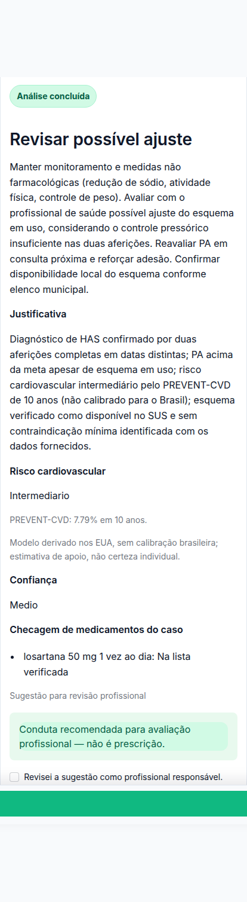
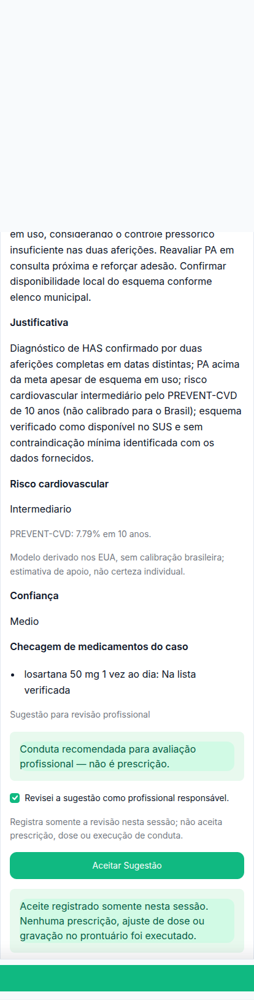

# Case study

## Context

The work started from a narrow observation about primary care in Brazil. Hypertension is the most frequent reason for a consultation, the conduct is well defined by a national protocol, and the gap between the protocol and the consultation is not knowledge. Clinicians know the thresholds. The gap is time and sequence: four decisions have to happen in a twelve-minute visit, and the one that gets skipped is usually the one without a form field.

The project was built as an independent product exercise, not as a contract. That freedom shaped it. There was no client asking for a dashboard, no integration to preserve and no legacy to accommodate, which meant the interesting question could be the constraint rather than the surface: what does a language model have to be prevented from doing before a clinician can use its output at all.

## The constraint

The constraint was stated at the start and did not change: the system suggests, the professional decides, and no output may read as a prescription. Everything else followed from it.

That constraint rules out a certain kind of product. It rules out auto-fill into a record, because a suggestion that writes itself is a prescription with extra steps. It rules out a chat interface, because a conversation invites the model to answer whatever is asked and hides the trail. It rules out a confidence score presented as probability of correctness, because nothing in the build measures that.

What remains is a form, a visible reasoning trail and a suggestion with its gaps listed. That is a smaller product and a more honest one.

## What was built

A Streamlit page in three columns: the case on the left, the agent's trail in the middle, the conduct on the right. A domain package of six tools, a ported risk model, Pydantic schemas at every boundary, an egress guard, and a set of invariants over the model's text. A prompt that is versioned with the code and loaded by path. A suite of 46 offline tests. A Docker image. A validation run on a synthetic case, with screenshots.

The validation case is a 55-year-old man with two elevated readings, no diabetes, no statin, and a lipid panel that supports a risk calculation. PREVENT returns 7.79 percent, the protocol places him at intermediate risk with stage 1 hypertension, and the suggested conduct is to adjust the dose with medium confidence and two pending items: a second confirmation outside the consultation and a renal function recheck.

The screenshot is worth reading closely, because it shows what the product does not do. There is no prescription line. There is a class, a rationale with citations, and a list of what remains open. The accept button is a separate act, and the state after acceptance is still a session.

## What broke

Three things, in order of cost.

The first was trusting the model with arithmetic. An early version let the model compute the risk stratum from the percentage and the comorbidities, with the coefficients in the prompt. It was right most of the time and wrong in ways that were invisible, because a wrong stratum produces a fluent paragraph. Moving the mapping into code removed the class of error and also removed the model's ability to explain a nuance the code did not encode. That trade is the central one in the project.

The second was extraction. The first parser was permissive: it looked for numbers near keywords and took the first plausible value. On a synthetic lab report with a previous result and a current result, it took the previous one. The fix was not a better parser but a different contract: extract only when the pattern is unambiguous, and put everything else in front of the clinician. Coverage fell and correctness rose, which was the right direction for a clinical input.

The third was the trail itself. Early versions rendered the tool calls as a log, and a log is not an explanation. The trail became useful when each entry showed the argument the model chose, the value the function returned and the sentence the model wrote about it, in that order. The middle column is now the part of the interface that a clinician would actually read.

## What the numbers say

Forty-six tests pass offline. The red-flag gate blocks a case with a troponin of 2.5 before any network call, verified by asserting the sequence of calls rather than the final text. The risk model reproduces the reference value for the validation case to two decimals.

The benchmark is the number that matters: 50 synthetic cases, a reference conduct written by hand for each, 40 percent agreement, no critical error under the criteria implemented, and every case routed to human review. The disagreements cluster in two places. The agent is more conservative than the reference on patients with a single elevated reading and no target organ damage, and it is less specific about the choice between two first-line classes when the comorbidity profile allows both. The first cluster is a prompt problem. The second is a product problem: the protocol genuinely allows either, and the interface should present a choice rather than a recommendation.

## What I would do next

Calibrate or replace the risk model, because a score derived from a North American cohort is a placeholder in a Brazilian primary care tool and the interface should not carry that caveat indefinitely. Run a prospective evaluation with a protocol for disagreements, so the 60 percent that differ are classified by cause instead of counted. Build the audit trail that survives the session, with reviewer identity and protocol version, because a suggestion that cannot be reconstructed later is not a record.

And keep the gate where it is. Of everything in the build, the preflight is the piece that most changes what the product is: a system that refuses to answer a hypertension question in a cardiac case is a system that has an opinion about its own scope.
