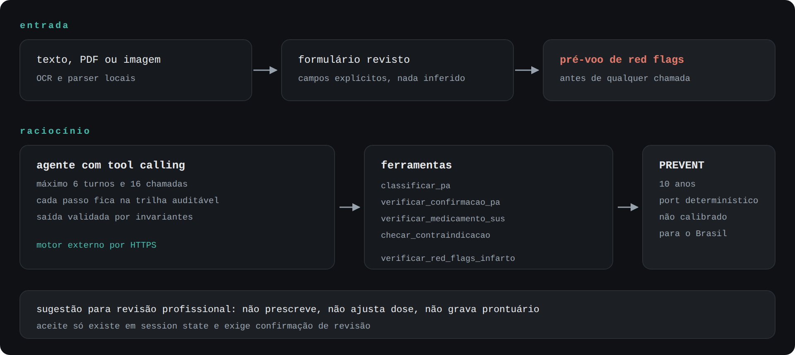

# Arquitetura

O Pulso+ é uma aplicação Python única com uma dependência externa: um endpoint de chat completion com suporte a tool calling. Tudo o que decide um limiar clínico roda dentro do processo, em código que pode ser lido e testado sem modelo.

## O caminho de uma consulta

Uma consulta é uma passagem por cinco etapas, e a aplicação guarda o estado dessa passagem na sessão.

**Entrada.** O profissional digita o caso no formulário ou envia uma anotação de consulta. Texto é aceito como está. PDF e imagem passam por extração local: Poppler para a camada do PDF, Tesseract para imagens, com um parser que só aceita padrões reconhecíveis e deixa o resto de fora. O resultado da entrada é uma proposta, nunca um formulário preenchido.

**Revisão.** A proposta cai no mesmo formulário que o profissional teria digitado, com cada campo extraído visível e editável. É o único lugar onde a aplicação admite incerteza sobre a entrada, e é de propósito: uma extração errada que chega ao motor produz uma conduta errada com trilha limpa, o que é pior do que um campo vazio.

**Pré-voo.** Antes de chamar o motor, o portão de sinais de alarme inspeciona os exames. Troponina acima do limite de referência ou CK-MB elevada encerram a passagem com uma declaração de emergência e marcação de revisão humana. O portão fica nessa posição porque o modelo não deve receber a oportunidade de raciocinar sobre pressão arterial em um caso que não é de pressão arterial.

**Raciocínio.** O laço do agente envia o caso estruturado e as definições de ferramenta ao endpoint, recebe chamadas de ferramenta ou uma mensagem final, executa as ferramentas localmente e anexa os resultados à conversa. O laço termina na mensagem final, em seis turnos ou em dezesseis chamadas de ferramenta, o que vier primeiro.

**Saída.** A mensagem final é convertida em objeto tipado, checada contra os invariantes, renderizada na coluna de conduta e oferecida para aceite. O aceite grava no estado da sessão e em nenhum outro lugar.

## Mapa de módulos

| Caminho | Responsabilidade |
| --- | --- |
| `app.py` | Layout, formulário, três colunas, estado da sessão, fluxo de aceite |
| `src/has_cdss/schemas.py` | Modelos Pydantic do caso, dos resultados de ferramenta e da saída final |
| `src/has_cdss/tools.py` | As seis ferramentas clínicas, funções puras sobre entrada tipada |
| `src/has_cdss/prevent.py` | Modelo PREVENT-CVD de dez anos, coeficientes portados |
| `src/has_cdss/agent.py` | Laço, despacho de ferramentas, orçamento, resolução do prompt, parse da saída |
| `src/has_cdss/guardrails.py` | Invariantes aplicados ao texto do modelo antes da renderização |
| `src/has_cdss/public_network.py` | Guarda de saída: esquema, porta, classe de endereço, fixação de IP, sem proxy ambiente |
| `src/has_cdss/formatting.py` | Formatação, unidades, notação de pressão |
| `prompts/system_prompt.md` | Instrução operacional, versionada junto com o código |
| `tests/` | Testes unitários e de regressão, `unittest discover` |

O pacote resolve o prompt por `parents[2] / "prompts" / "system_prompt.md"`, o que significa que o prompt viaja com o pacote e não pode divergir silenciosamente do código em uma imagem publicada. Não existe arquivo de configuração apontando para um prompt em outro lugar.

## Contratos das ferramentas

Cada ferramenta recebe um modelo Pydantic e devolve outro. Nenhuma devolve string, nenhuma registra texto livre. Essa restrição é o que torna a trilha útil: a coluna do meio renderiza argumentos e resultados como dados, e os invariantes conseguem comparar o que o modelo escreveu com o que as ferramentas realmente devolveram.

| Ferramenta | Entrada | Saída |
| --- | --- | --- |
| `verificar_red_flags_infarto` | Troponina, CK-MB, sintomas | Booleano, motivo, ação exigida |
| `classificar_pa` | Sistólica, diastólica, contexto | Estágio, rótulo, referência do protocolo |
| `verificar_confirmacao_pa` | Duas ou mais medidas | Confirmado, pendente, repetições recomendadas |
| `estratificar_risco_cardio` | Idade, sexo, pressão, lipídios, TFG, tabagismo, diabetes, tratamento | Percentual, estrato, procedência do modelo |
| `verificar_medicamento_sus` | Nome do fármaco, apresentação | Disponível, alternativa, fonte |
| `checar_contraindicacao` | Classe, comorbidades, gestação, função renal | Permitido, proibido, motivo |

As descrições entregues ao modelo são curtas e imperativas, porque o modo de falha de uma descrição longa é o modelo chamar a ferramenta por formalidade, depois de já ter decidido. Cada descrição diz quando a ferramenta precisa ser chamada, não apenas o que ela calcula.

## O laço do agente

O laço é pequeno de propósito. Guarda uma lista de mensagens, um contador de turnos e um contador de chamadas. A cada iteração envia a lista e os esquemas das ferramentas e, em seguida, despacha as ferramentas pedidas ou encerra. Erros de ferramenta voltam ao modelo como erro estruturado em vez de exceção, então um argumento malformado gera tentativa de correção e não uma sessão quebrada. Quando o orçamento acaba, o laço sintetiza um resultado parcial que nomeia o que não foi concluído; ele não pede ao modelo para resumir uma trilha que não terminou.

Dois detalhes importam para reprodutibilidade. A temperatura é baixa e as definições de ferramenta são ordenadas, então o mesmo caso produz a mesma ordem de chamadas em quase toda execução. A trilha é guardada como lista de registros com nome da ferramenta, argumentos, resultado e tempo decorrido, que é o que a interface renderiza e o que o revisor lê.

## Guarda de saída

`public_network.py` existe porque o endpoint é configurável. Um profissional ou avaliador pode apontar a aplicação para qualquer URL compatível com OpenAI, e essa URL é um lugar para onde credenciais e texto clínico iriam. A guarda impõe quatro regras antes de abrir conexão: apenas HTTPS, apenas porta 443, o endereço resolvido precisa ser público e global, e a conexão é feita no endereço fixado com o host original preservado para TLS e SNI. Variáveis de proxy do ambiente são ignoradas, para que um ambiente não redirecione a chamada em silêncio. Redirecionamentos não são seguidos.

Isso não substitui política de rede. É a checagem que faz um endpoint mal configurado falhar alto na fronteira, em vez de enviar um caso para um endereço que nunca deveria recebê-lo.

## Modos de falha

| Falha | Comportamento |
| --- | --- |
| Modelo devolve prosa em vez de chamada de ferramenta | Tratado como mensagem final, invariantes aplicados, pendências listadas |
| Argumento de ferramenta inválido | Erro estruturado devolvido ao modelo, uma nova tentativa, depois relato |
| Orçamento esgotado | Saída parcial com lacunas explícitas, sem botão de aceite |
| Endpoint inacessível | Estado de erro na coluna de raciocínio, formulário preservado, nada perdido |
| Endpoint resolve para endereço privado | Recusado pela guarda, mensagem nomeia o motivo |
| Extração não produz nada utilizável | Formulário vazio, nenhum valor inventado |
| Saída introduz fármaco ou dose que as ferramentas não devolveram | Invariante bloqueia o bloco, saída marcada como incompleta |

## Implantação

A imagem é um build Docker com o pacote, o prompt, as fontes locais e um conjunto de dependências fixado. O modo público liga uma flag que desativa o carregamento de `.env` e a chave global de fallback, então uma publicação sem chave de sessão simplesmente não consegue chamar o motor. Saúde é a renderização da página, não um endpoint de liveness, porque a falha que importa aqui é a página que carrega com sessão quebrada.

## Testes

`unittest discover` roda a suíte sem acesso à rede. Os testes cobrem os estágios de pressão nas fronteiras, a regra de confirmação com uma e com duas medidas, o modelo de risco contra valores de referência, a matriz de contraindicação, o portão de sinais de alarme com troponina elevada, os esquemas com campos ausentes e fora de faixa, a guarda de saída com endereços de loopback e de metadados, e os invariantes com uma dose fabricada. A suíte não é validação clínica; é a garantia de que a parte determinística continua determinística.
