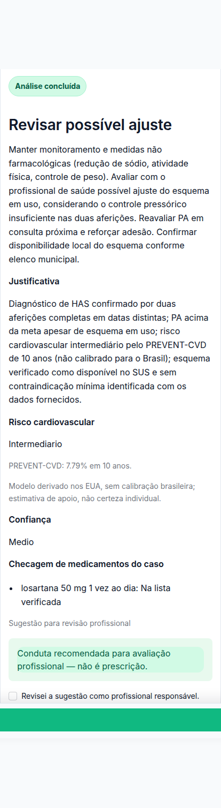
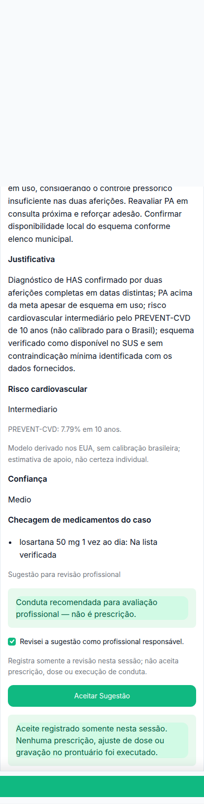

# Estudo de caso

## Contexto

O trabalho começou de uma observação estreita sobre a atenção primária no Brasil. Hipertensão é o motivo mais frequente de consulta, a conduta está bem definida por um protocolo nacional, e a distância entre o protocolo e a consulta não é conhecimento. Os profissionais sabem os limiares. A distância é tempo e sequência: quatro decisões precisam acontecer em uma consulta de doze minutos, e a que fica de fora costuma ser a que não tem campo no formulário.

O projeto foi construído como exercício independente de produto, não como contrato. Essa liberdade moldou tudo. Não havia cliente pedindo painel, nem integração a preservar, nem legado a acomodar, o que significava que a pergunta interessante podia ser a restrição e não a superfície: do que um modelo de linguagem precisa ser impedido antes que um clínico possa usar a saída dele.

## A restrição

A restrição foi declarada no começo e não mudou: o sistema sugere, o profissional decide, e nenhuma saída pode ler como prescrição. O resto veio daí.

Essa restrição elimina um certo tipo de produto. Elimina preenchimento automático de prontuário, porque sugestão que se escreve sozinha é prescrição com etapas extras. Elimina interface de conversa, porque conversa convida o modelo a responder o que for perguntado e esconde a trilha. Elimina escore de confiança apresentado como probabilidade de acerto, porque nada no build mede isso.

O que sobra é formulário, trilha de raciocínio visível e sugestão com as lacunas listadas. É um produto menor e mais honesto.

## O que foi construído

Uma página Streamlit em três colunas: o caso à esquerda, a trilha do agente no meio, a conduta à direita. Um pacote de domínio com seis ferramentas, um modelo de risco portado, esquemas Pydantic em cada fronteira, guarda de saída e um conjunto de invariantes sobre o texto do modelo. Um prompt versionado com o código e carregado por caminho. Uma suíte de 46 testes offline. Uma imagem Docker. Uma validação em caso sintético, com capturas.

O caso de validação é um homem de 55 anos com duas medidas elevadas, sem diabetes, sem estatina, e um perfil lipídico que sustenta o cálculo de risco. O PREVENT devolve 7,79 por cento, o protocolo o coloca em risco intermediário com hipertensão estágio 1, e a conduta sugerida é ajustar a dose com confiança média e dois itens pendentes: confirmação fora da consulta e rechecagem de função renal.

Vale ler a captura com atenção, porque ela mostra o que o produto não faz. Não existe linha de prescrição. Existe uma classe, uma justificativa com citações e uma lista do que continua aberto. O botão de aceite é um ato separado, e o estado depois do aceite continua sendo sessão.

## O que quebrou

Três coisas, em ordem de custo.

A primeira foi confiar aritmética ao modelo. Uma versão inicial deixava o modelo calcular o estrato de risco a partir do percentual e das comorbidades, com os coeficientes no prompt. Acertava na maior parte do tempo e errava de formas invisíveis, porque estrato errado produz parágrafo fluente. Levar o mapeamento para o código removeu a classe de erro e também removeu a capacidade do modelo de explicar uma nuance que o código não codificava. Essa troca é a central do projeto.

A segunda foi extração. O primeiro parser era permissivo: procurava números perto de palavras-chave e pegava o primeiro valor plausível. Em um laudo sintético com resultado anterior e resultado atual, ele pegou o anterior. A correção não foi um parser melhor, mas um contrato diferente: extrair apenas quando o padrão é inequívoco, e colocar todo o resto na frente do profissional. A cobertura caiu e a correção subiu, que era a direção certa para uma entrada clínica.

A terceira foi a própria trilha. Versões iniciais renderizavam as chamadas como log, e log não é explicação. A trilha ficou útil quando cada entrada passou a mostrar o argumento que o modelo escolheu, o valor que a função devolveu e a frase que o modelo escreveu sobre ele, nessa ordem. A coluna do meio é hoje a parte da interface que um clínico realmente leria.

## O que os números dizem

Quarenta e seis testes passam offline. O portão de sinais de alarme bloqueia um caso com troponina de 2,5 antes de qualquer chamada de rede, verificado pela sequência de chamadas e não pelo texto final. O modelo de risco reproduz o valor de referência do caso de validação com duas casas decimais.

O benchmark é o número que importa: 50 casos sintéticos, uma conduta de referência escrita à mão para cada, 40 por cento de concordância, nenhum erro crítico pelos critérios implementados, e todos os casos encaminhados para revisão humana. As divergências se concentram em dois lugares. O agente é mais conservador que a referência em pacientes com uma única medida elevada e sem lesão de órgão-alvo, e é menos específico na escolha entre duas classes de primeira linha quando o perfil de comorbidades permite as duas. O primeiro grupo é problema de prompt. O segundo é problema de produto: o protocolo realmente permite qualquer uma das duas, e a interface deveria apresentar escolha, não recomendação.

## O que eu faria em seguida

Calibrar ou substituir o modelo de risco, porque escore derivado de coorte norte-americana é provisório em uma ferramenta de atenção primária brasileira e a interface não deveria carregar essa ressalva indefinidamente. Rodar avaliação prospectiva com protocolo para divergências, para que os 60 por cento que diferem sejam classificados por causa em vez de contados. Construir a trilha de auditoria que sobrevive à sessão, com identidade do revisor e versão do protocolo, porque sugestão que não pode ser reconstruída depois não é registro.

E manter o portão onde está. De tudo no build, o pré-voo é a peça que mais muda o que o produto é: um sistema que se recusa a responder pergunta de hipertensão em caso cardíaco é um sistema que tem opinião sobre o próprio escopo.
