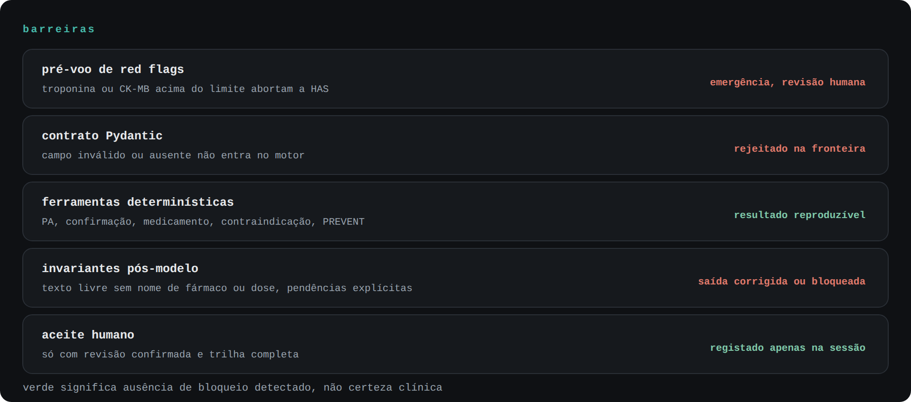

# Clinical safety

A decision support tool that is wrong quietly is more dangerous than one that is unavailable. The design of Pulso+ starts from that asymmetry: every layer is allowed to refuse, and the default state of an unfinished case is a visible gap rather than a plausible sentence.

## The two errors worth designing against

The first is a false negative in triage. A patient arrives with chest pain and a troponin of 2.5, and the consultation is recorded as a hypertension follow-up. The blood pressure is high, the protocol has something to say about it, and the answer looks complete. The patient is having an acute coronary event.

The second is a plausible but unverified conduct. The case is classified from one reading, the confirmation step never happens, the risk score is computed from an incomplete lipid panel, and the output reads as though all three steps were done. Nothing in the text signals that two of them were skipped.

Everything below addresses one of those two failures.

## Gate one: preflight

The gate runs on the structured case, before the endpoint is contacted, and it is a plain function with a regression test. The rules are explicit: a troponin above the reference limit, or an elevated CK-MB, with or without symptoms, ends the pass. The output states an emergency, names the finding, and marks the result as requiring human review. The hypertension engine is never invoked.

The test that guards this behaviour feeds a troponin of 2.5 and asserts that no tool call reaches the pressure classifier. The assertion is on the sequence of calls, not on the final text, because a system that reasons its way to the right answer through the wrong path will eventually reason its way to the wrong answer through the right one.

The gate is intentionally narrow. It covers acute coronary signs, which is the collision that motivated the product. It does not attempt to detect stroke, aortic dissection, pulmonary embolism or sepsis, and the documentation says so rather than implying a general triage capability.

## Gate two: the input contract

Pydantic validates the case at the boundary: types, ranges, required pairs. A systolic value below the diastolic value is rejected. A negative age is rejected. A lipid panel with total cholesterol but no HDL is accepted as incomplete, and the incompleteness is carried into the case as a flag rather than filled with a default.

The distinction between invalid and incomplete is the useful part. Invalid input stops the pass with a message. Incomplete input continues, and the gap is visible to the model and to the clinician.

## Gate three: deterministic tools

The model chooses which tool to call. It does not decide what the tool returns. Pressure staging, the confirmation rule, the risk arithmetic and the contraindication matrix are Python functions with unit tests at their boundaries, and the model receives their output as data.

This is the reason the product can be audited. A reviewer reading the trail sees the arguments the model passed and the values the functions produced, and can recompute any of them by hand. A reviewer reading a paragraph of model prose can only judge whether it sounds right.

The risk model deserves its own paragraph. `estratificar_risco_cardio` implements the ten-year PREVENT-CVD base model with the coefficients published in PyPREVENT. It returns the percentage, the stratum and a provenance note that states the cohort it came from and the fact that it is not calibrated for the Brazilian population. The protocol then decides what the stratum means in the presence of diabetes, target organ damage or established cardiovascular disease, and that mapping is code, not text.

## Gate four: invariants on the model's text

The final message is checked before it is rendered. The rules are few and blunt.

A drug name may only appear if a tool returned that drug for this case. A dose may only appear if a tool returned that dose. A confidence level must be present, and it must be one of the defined values. An unresolved item must be listed as unresolved, and the count of pending items must match the count of gaps in the trail. When a rule fails, the offending block is removed or the output is marked incomplete and the acceptance path closes.

The implementation is conservative in the direction that costs the least: it is allowed to remove a correct sentence, and it is not allowed to keep a fabricated one.

## Gate five: the human

The conduct column is labelled as a suggestion. Acceptance requires the output to be eligible and the trail to be complete, and the accepted state is stored in session state with a timestamp. There is no downstream write, no export, no notification, and no record that survives the session.

The button is a small thing with a large function. It makes the transfer of responsibility explicit and leaves a trace that a human read the output, which is the only audit that exists in this build.

## What is not claimed

Pulso+ is not a medical device and has no regulatory clearance in any jurisdiction. It has not been validated against real patient records, and it was not evaluated by clinicians in a prospective study. The protocol implementation reflects a specific edition of the Ministry of Health guideline, and a new edition would require a review of the thresholds, the drug list and the risk mapping.

The public build does not authenticate institutional identity, does not isolate tenants, and does not have a retention policy, because it does not retain anything. That is a property of the demonstration, not a compliance posture.

The prompt is visible to anyone with access to the deployment, and the model's behaviour is not adversarially hardened. A user who wants a particular answer can probably steer the conversation. The gates exist because the model can be steered; the deterministic layer is what remains when it is.

## Evaluation

The suite has 46 tests, all offline: boundary values for the pressure stages, the confirmation rule with one and two readings, the risk model against published reference values, the contraindication matrix, the red-flag gate, the schemas, the egress guard, and the invariants.

The benchmark used 50 synthetic cases written to cover the protocol's branches. Each case has a reference conduct written by hand from the guideline. The agent agreed with the reference in 40 percent of cases, produced no critical error under the criteria implemented, and every case was routed to human review. The criteria for critical error were narrow: a forbidden drug class for a documented comorbidity, an emergency finding not escalated, a stage assigned below the measured pressure. A wider definition would have produced a different number.

Forty percent is the honest figure, and it is the one that shaped the interface. A tool that agrees with a careful clinician four times in ten is useful as a checklist and dangerous as an authority. The trail, the pending list and the accept button exist because of that number, not despite it.

## The next layer

Three things would move this from a demonstration to something a clinic could trial. A calibration study of PREVENT against a Brazilian cohort, or a switch to a score derived from one. A prospective evaluation with a protocol for disagreements, so the 60 percent that differ are classified by cause rather than counted. And an audit trail that survives the session, with the identity of the reviewer and the version of the protocol, because a suggestion that cannot be reconstructed later is not a record.

None of those is a feature. Each is a study or an institutional commitment, and the product should not pretend otherwise.
