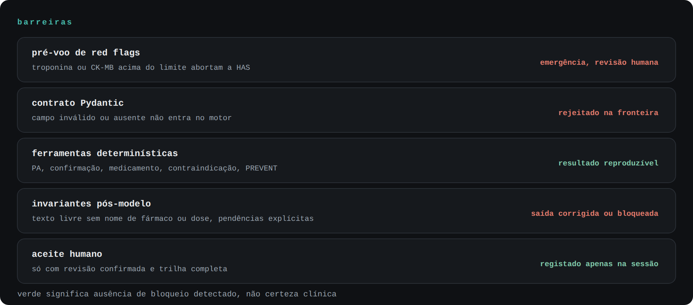

# Segurança clínica

Uma ferramenta de apoio à decisão que erra em silêncio é mais perigosa do que uma que está indisponível. O desenho do Pulso+ parte dessa assimetria: toda camada pode recusar, e o estado padrão de um caso inacabado é uma lacuna visível, não uma frase plausível.

## Os dois erros que o desenho combate

O primeiro é o falso negativo na triagem. Um paciente chega com dor torácica e troponina de 2,5, e a consulta é registrada como acompanhamento de hipertensão. A pressão está alta, o protocolo tem algo a dizer sobre isso, e a resposta parece completa. O paciente está em evento coronariano agudo.

O segundo é a conduta plausível e não verificada. O caso é classificado a partir de uma medida, a confirmação nunca acontece, o escore de risco é calculado de um perfil lipídico incompleto, e a saída lê como se as três etapas tivessem sido feitas. Nada no texto sinaliza que duas foram puladas.

Tudo abaixo trata um desses dois problemas.

## Barreira um: pré-voo

O portão roda sobre o caso estruturado, antes de qualquer contato com o endpoint, e é uma função simples com teste de regressão. As regras são explícitas: troponina acima do limite de referência, ou CK-MB elevada, com ou sem sintomas, encerram a passagem. A saída declara emergência, nomeia o achado e marca o resultado como exigindo revisão humana. O motor de hipertensão nunca é acionado.

O teste que protege esse comportamento injeta troponina de 2,5 e verifica que nenhuma chamada de ferramenta alcança o classificador de pressão. A verificação é sobre a sequência de chamadas, não sobre o texto final, porque um sistema que chega à resposta certa pelo caminho errado vai, mais cedo ou mais tarde, chegar à resposta errada pelo caminho certo.

O portão é estreito de propósito. Cobre sinais coronarianos agudos, que é a colisão que motivou o produto. Não tenta detectar AVC, dissecção de aorta, tromboembolismo pulmonar ou sepse, e a documentação diz isso em vez de sugerir capacidade geral de triagem.

## Barreira dois: contrato de entrada

O Pydantic valida o caso na fronteira: tipos, faixas, pares obrigatórios. Sistólica menor que diastólica é recusada. Idade negativa é recusada. Perfil lipídico com colesterol total e sem HDL é aceito como incompleto, e a incompletude é carregada no caso como sinalização, em vez de preenchida com valor padrão.

A distinção entre inválido e incompleto é a parte útil. Entrada inválida interrompe a passagem com mensagem. Entrada incompleta segue, e a lacuna fica visível para o modelo e para o profissional.

## Barreira três: ferramentas determinísticas

O modelo escolhe qual ferramenta chamar. Ele não decide o que a ferramenta devolve. Estadiamento de pressão, regra de confirmação, aritmética de risco e matriz de contraindicação são funções Python com testes unitários nas fronteiras, e o modelo recebe a saída delas como dado.

É por isso que o produto pode ser auditado. Um revisor lendo a trilha vê os argumentos que o modelo passou e os valores que as funções produziram, e consegue recalcular qualquer um à mão. Um revisor lendo um parágrafo de prosa do modelo só consegue julgar se soa certo.

O modelo de risco merece parágrafo próprio. `estratificar_risco_cardio` implementa o PREVENT-CVD de dez anos (modelo-base) com os coeficientes publicados no PyPREVENT. Devolve o percentual, o estrato e uma nota de procedência que declara a coorte de origem e o fato de não ser calibrado para a população brasileira. O protocolo então decide o que o estrato significa na presença de diabetes, lesão de órgão-alvo ou doença cardiovascular estabelecida, e esse mapeamento é código, não texto.

## Barreira quatro: invariantes sobre o texto do modelo

A mensagem final é checada antes de ser renderizada. As regras são poucas e diretas.

Um nome de fármaco só pode aparecer se uma ferramenta devolveu aquele fármaco para este caso. Uma dose só pode aparecer se uma ferramenta devolveu aquela dose. O nível de confiança precisa estar presente e precisa ser um dos valores definidos. Um item não resolvido precisa estar listado como não resolvido, e a contagem de pendências precisa bater com a contagem de lacunas na trilha. Quando uma regra falha, o bloco ofensivo é removido ou a saída é marcada como incompleta e o caminho de aceite fecha.

A implementação é conservadora na direção que custa menos: pode remover uma frase correta, não pode manter uma inventada.

## Barreira cinco: a pessoa

A coluna de conduta é rotulada como sugestão. O aceite exige que a saída seja elegível e a trilha esteja completa, e o estado aceito é guardado no estado da sessão com data e hora. Não existe gravação a jusante, exportação, notificação ou registro que sobreviva à sessão.

O botão é uma coisa pequena com uma função grande. Torna explícita a transferência de responsabilidade e deixa rastro de que uma pessoa leu a saída, que é a única auditoria existente nesta versão.

## O que não é alegado

O Pulso+ não é dispositivo médico e não tem registro em órgão regulador em nenhuma jurisdição. Não foi validado contra prontuários reais e não foi avaliado por clínicos em estudo prospectivo. A implementação do protocolo reflete uma edição específica da diretriz do Ministério da Saúde, e uma nova edição exigiria revisão dos limiares, da lista de fármacos e do mapeamento de risco.

A versão pública não autentica identidade institucional, não isola inquilinos e não tem política de retenção, porque não retém nada. Isso é propriedade da demonstração, não postura de conformidade.

O prompt é visível para qualquer pessoa com acesso à publicação, e o comportamento do modelo não é endurecido contra adversário. Um usuário que quer uma resposta específica provavelmente consegue conduzir a conversa. As barreiras existem porque o modelo pode ser conduzido; a camada determinística é o que resta quando ele é.

## Avaliação

A suíte tem 46 testes, todos offline: valores de fronteira dos estágios de pressão, regra de confirmação com uma e duas medidas, modelo de risco contra valores publicados, matriz de contraindicação, portão de sinais de alarme, esquemas, guarda de saída e invariantes.

O benchmark usou 50 casos sintéticos escritos para cobrir os ramos do protocolo. Cada caso tem uma conduta de referência escrita à mão a partir da diretriz. O agente concordou com a referência em 40 por cento dos casos, não produziu erro crítico pelos critérios implementados, e todos os casos foram encaminhados para revisão humana. O critério de erro crítico era estreito: classe proibida diante de comorbidade documentada, achado de emergência não escalado, estágio atribuído abaixo da pressão medida. Uma definição mais ampla produziria outro número.

Quarenta por cento é o número honesto, e foi ele que moldou a interface. Uma ferramenta que concorda com um clínico cuidadoso quatro vezes em dez é útil como checklist e perigosa como autoridade. A trilha, a lista de pendências e o botão de aceite existem por causa desse número, não apesar dele.

## A próxima camada

Três coisas levariam isto de demonstração a algo que uma clínica poderia testar. Um estudo de calibração do PREVENT em coorte brasileira, ou a troca por um escore derivado de uma. Uma avaliação prospectiva com protocolo para divergências, para que os 60 por cento que diferem sejam classificados por causa em vez de contados. E uma trilha de auditoria que sobreviva à sessão, com identidade do revisor e versão do protocolo, porque uma sugestão que não pode ser reconstruída depois não é registro.

Nenhuma dessas é funcionalidade. Cada uma é estudo ou compromisso institucional, e o produto não deve fingir o contrário.
